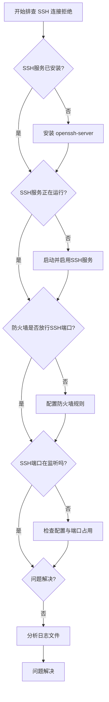

---

问题：

ubuntu 桌面是不是可以不用输入密码直接登录？

回答：

是的，Ubuntu 桌面完全可以设置成免密码自动登录，这对于家庭或个人使用的电脑来说，能省去每次开机输入密码的麻烦。

下表对比了两种主要的设置方法，你可以根据自己使用的 Ubuntu 版本和偏好进行选择。

| 特性 | 通过图形界面设置 (推荐) | 通过命令行修改配置文件 |
| :--- | :--- | :--- |
| **操作方式** | 图形化界面，点击即可 | 终端命令，编辑文本文件 |
| **易用性** | ⭐️⭐️⭐️⭐️⭐️ (非常简单) | ⭐️⭐️ (需熟悉命令行) |
| **适用版本** | 大多数现代桌面版 Ubuntu (如 16.04及之后) | 所有版本，尤其适用于无图形界面的服务器或旧版 |
| **安全性提示** | 便捷但会降低安全性，请确保电脑在受控环境中。 | 同左，修改系统核心配置需格外谨慎。 |

### 🖥️ 图形界面设置步骤（首选）

这是最直观、最安全的方法，适用于绝大多数用户。

1.  **打开设置**：点击屏幕右上角的系统菜单，选择**设置**（Settings）。
2.  **进入用户账户**：在设置窗口中，找到并点击**用户**（Users）或**用户账户**（User Accounts）。
3.  **解锁设置**：点击窗口右上角的**解锁**（Unlock）按钮，然后根据提示输入你当前的用户密码进行授权。
4.  **开启自动登录**：成功解锁后，你会发现**自动登录**（Automatic Login）选项从灰色不可点变为可设置状态。将其开关切换到**开启**（ON）即可。
5.  **完成**：重新启动电脑，系统将不再显示登录界面，直接进入桌面。

### ⌨️ 通过配置文件设置

如果你的系统因为某些原因（例如版本较旧）没有图形界面设置选项，可以通过修改显示管理器（Display Manager）的配置文件来实现。常见的显示管理器是 LightDM。

1.  **打开终端**，使用以下命令编辑配置文件（需要管理员权限）：
    ```bash
    sudo nano /etc/lightdm/lightdm.conf
    ```
    （如果此文件不存在，可能需要先创建或编辑其子目录下的文件，如 `/etc/lightdm/lightdm.conf.d/50-myconfig.conf`）

2.  **添加配置**：在配置文件中找到 `[Seat:*]` 部分，或直接添加以下内容：
    ```
    [Seat:*]
    autologin-user=你的用户名
    autologin-guest=false
    autologin-user-timeout=0
    ```
    请将 `你的用户名` 替换为你实际的登录用户名。

3.  **保存并退出**：在 nano 编辑器中，按 `Ctrl+O` 保存，按 `Ctrl+X` 退出。
4.  **重启生效**：重启系统后，设置就会生效。

### ⚠️ 重要安全提醒

在享受便利的同时，请务必了解其带来的安全风险：

*   **降低安全性**：自动登录意味着任何能物理接触到你这台电脑的人都可以直接打开并使用你的账户，访问所有文件和资料。**请仅在家庭等受控的、可信的安全环境中使用此功能。**
*   **密钥环解锁问题**：如果你设置了自动登录，在首次连接 Wi-Fi 或打开某些需要密钥环的应用（如浏览器）时，系统可能仍会弹窗要求你输入密码以“解锁密钥环”。这是因为自动登录过程并未将你的登录密码传递给负责管理各类密码的“密钥环”程序。

希望这些信息能帮助你更方便地使用 Ubuntu！如果你在操作中遇到任何问题，比如不确定用户名或修改配置时出错，可以随时告诉我。

---

问题：

ubuntu 桌面可以息屏吗？

回答：

是的，Ubuntu 桌面完全可以息屏。这通常被称为"屏幕空白"或"屏幕保护"，是系统为了节省电量或安全而设计的常规功能。

下面这个表格能帮你快速了解触发息屏的几种主要方式。

| 触发方式 | 具体方法 | 关键说明 |
| :--- | :--- | :--- |
| **手动立即息屏/锁屏** | 按下键盘上的 `Super` + `L` 键 或 `Ctrl` + `Alt` + `L` | `Super` 键通常是键盘上带有 Windows 图标的键。这是最快捷的方式。 |
| **系统自动息屏** | 在设定的无操作时间后自动触发。 | 默认情况下，Ubuntu 通常在 5 分钟无操作后自动息屏。 |

### 🛠️ 调整自动息屏设置

如果你觉得默认的息屏时间不合适，可以轻松地进行调整。

- **通过图形界面设置（推荐）**
    1.  打开**设置**（Settings）。
    2.  找到并进入**电源**（Power）选项。
    3.  在相关选项卡中（如"节电"或"显示"），你会找到名为**息屏**（Blank screen）的设置项。
    4.  在下拉菜单中，你可以选择一个新的时间（例如10分钟、30分钟），或者选择**从不**（Never）来完全禁用自动息屏。

- **通过命令行设置**
    如果你习惯使用终端，可以使用强大的 `gsettings` 命令。
    - **查看当前设置**：
      ```bash
      gsettings get org.gnome.desktop.session idle-delay
      ```
      这个命令会返回一个以秒为单位的数字，例如 `uint32 300` 代表300秒（5分钟）。
    - **设置永不息屏**：
      ```bash
      gsettings set org.gnome.desktop.session idle-delay 0
      ```
      将值设为 `0` 即可禁用自动息屏。
    - **恢复自动息屏**：只需将命令中的 `0` 替换为你想要的秒数即可，例如 `900` 代表15分钟。

### 💡 息屏与锁屏、睡眠的区别

了解这些概念的区别有助于你更好地管理电脑：
*   **息屏**：仅仅关闭显示器背光以省电，但电脑的所有程序仍在正常运行。
*   **锁屏**：在息屏的基础上，要求输入密码才能重新进入桌面，主要用于保护隐私和安全。手动息屏操作（如按 `Super+L`）通常会同时触发息屏和锁屏。
*   **睡眠/挂起**：将当前系统的状态保存到内存中，整个电脑进入低功耗状态，比息屏和锁屏更省电。唤醒时需要一点时间来恢复。

希望这些信息能帮助你更好地管理你的 Ubuntu 桌面屏幕！如果你对调整其他电源相关设置（如自动睡眠）也感兴趣，我很乐意提供进一步帮助。

---

问题：

我在同一个 wifi 网络的电脑上，安装了一个 ubuntu 操作系统，我想 ssh 连接到这个 ubuntu 电脑，我 ping ubuntu 电脑的 IP 地址，可以访问。但是 ssh 连接提示拒绝连接，帮我解决一下

回答：

你遇到的问题很典型，能 ping 通说明网络是连通的，但 SSH 连接被拒绝，这通常意味着 Ubuntu 电脑上的 SSH 服务未正常运行或配置有误。我们可以按照下图的流程来系统地排查问题。



下面是每个步骤需要执行的详细命令和解释。

### 🔧 检查并安装 SSH 服务
首先，需要确认 Ubuntu 上是否安装了 SSH 服务端程序（openssh-server）。
1.  **检查安装情况**：在 Ubuntu 电脑上打开终端，输入以下命令：
    ```bash
    sudo systemctl status ssh
    ```
    *   如果输出显示 `Active: active (running)`，则表示服务已启动，请跳至下一步骤。
    *   如果显示 `Unit ssh.service could not be found` 或类似信息，说明 **未安装** openssh-server。
    *   如果显示 `Active: inactive (dead)`，说明已安装但未运行。

2.  **安装 SSH 服务**：如果确认未安装，请运行以下命令来安装：
    ```bash
    sudo apt update
    sudo apt install openssh-server
    ```
3.  **启动并启用服务**：安装后，SSH 服务通常会自行启动。如果没有，或者之前处于未运行状态，请使用以下命令启动并设置为开机自启：
    ```bash
    sudo systemctl start ssh
    sudo systemctl enable ssh
    ```

### 🔥 配置防火墙允许 SSH 连接
Ubuntu 默认的防火墙工具 UFW 可能会阻止 SSH 连接。你需要确保放行 SSH 端口（默认为 22）。
1.  **检查 UFW 状态**：
    ```bash
    sudo ufw status
    ```
    *   如果状态是 `inactive`，说明防火墙未启用，暂时不是它的问题。
    *   如果状态是 `active`，继续下一步。

2.  **放行 SSH 端口**：如果防火墙是激活状态，请确保允许 SSH 连接：
    ```bash
    sudo ufw allow ssh
    ```
    *   或者直接指定端口号，例如 `sudo ufw allow 22/tcp`。
    *   之后，可以重新加载防火墙规则使其生效：`sudo ufw reload`。

### ⚙️ 检查 SSH 服务配置与端口监听
1.  **确认 SSH 端口处于监听状态**：执行以下命令，查看 SSH 服务是否在正常监听 22 端口：
    ```bash
    sudo netstat -tuln | grep 22
    ```
    如果配置正确，你应该能看到类似 `tcp 0 0.0.0.0:22 0.0.0.0:* LISTEN` 的输出。

2.  **检查 SSH 配置文件**：SSH 服务的主要配置文件是 `/etc/ssh/sshd_config`。你可以检查其中几个关键设置：
    *   **Port**：确认端口号是 22（默认）。
    *   **ListenAddress**：确认是否为 `0.0.0.0`（监听所有网络接口）。
    *   **PermitRootLogin**：是否允许 root 登录，可以先检查此项是否被设置为 `no` 而导致你使用的账户无法登录。
    *   **PasswordAuthentication**：是否允许密码认证，如果设置为 `no` 而你未使用密钥，也会被拒绝。
    修改配置后，需要重启 SSH 服务：`sudo systemctl restart ssh`。

### 📊 查看日志定位更深层原因
如果以上步骤未能解决问题，查看系统日志是定位故障的关键。
*   **查看 SSH 相关日志**：使用以下命令查看最新的 SSH 连接日志信息：
    ```bash
    sudo tail -f /var/log/auth.log
    ```
    尝试从另一台电脑再次进行 SSH 连接，观察此时 Ubuntu 电脑的日志输出，里面通常会包含连接被拒绝的具体原因。

### 💎 其他可能性
*   **SSH 服务启动失败**：如果 `systemctl status ssh` 显示服务启动失败，可能是配置文件有语法错误、端口被其他进程占用或密钥文件权限问题。可以尝试运行 `sshd -t` 检查配置文件语法，或查看日志 `/var/log/syslog`/`/var/log/auth.log` 获取详细错误信息。
*   **使用了非标准端口**：如果 SSH 服务配置为使用非 22 端口（如 2222），那么在客户端连接时需要使用 `-p` 选项指定端口，例如 `ssh username@ip -p 2222`。

希望这些步骤能帮助你解决问题。请从第一步开始逐一检查，通常就能找到原因。如果尝试后仍有困难，可以告诉我排查到哪一步出现了什么情况，我会尽力提供进一步的分析。

---

问题：

ubuntu 中如何安装 oh-my-zsh

回答：

在Ubuntu上安装oh-my-zsh可以显著提升终端的使用体验。下面我将为你梳理详细的安装步骤、配置方法以及一些实用技巧。

### 🔧 安装步骤

首先，你需要安装Zsh，然后通过官方脚本安装oh-my-zsh。以下是具体步骤：

| 步骤 | 操作 | 关键命令 |
| :--- | :--- | :--- |
| **1. 安装Zsh** | 更新软件包列表并安装Zsh。 | `sudo apt update && sudo apt install zsh`  |
| **2. 安装oh-my-zsh** | 使用官方一键脚本安装（需curl或wget）。 | `sh -c "$(curl -fsSL https://raw.githubusercontent.com/ohmyzsh/ohmyzsh/master/tools/install.sh)"`  |
| **3. 设置默认Shell** | 将Zsh设置为你的默认Shell。 | `chsh -s $(which zsh)`  或 `sudo chsh -s /bin/zsh`  |
| **4. 生效配置** | 重新加载配置文件或**重新登录终端**。 | `source ~/.zshrc`  |

如果由于网络问题无法通过官方脚本安装，也可以选择手动安装 ：
```bash
git clone https://github.com/ohmyzsh/ohmyzsh.git ~/.oh-my-zsh
cp ~/.oh-my-zsh/templates/zshrc.zsh-template ~/.zshrc
```

### 🎨 个性化配置

安装完成后，你可以通过修改 `~/.zshrc` 配置文件来定制你的终端。

- **更换主题**：oh-my-zsh 提供了大量主题。你可以在 `~/.zshrc` 文件中修改 `ZSH_THEME` 变量的值来更换主题。例如，设置为 `"agnoster"` 可以启用一款非常流行的Powerline风格主题 。你可以在 https://github.com/ohmyzsh/ohmyzsh/wiki/Themes 查看所有可用主题 。
- **安装插件**：插件能极大增强zsh的功能。推荐安装以下几个常用插件：
    - **zsh-autosuggestions**: 能根据历史命令为你的输入提供智能提示 。
    - **zsh-syntax-highlighting**: 对你输入的命令进行高亮显示，正确命令为绿色，错误命令为红色，非常直观 。
    - **autojump**: 可以让你快速跳转到曾经访问过的目录 。

安装这些插件通常很简单，以 `zsh-autosuggestions` 为例，只需执行以下命令然后将其添加到 `~/.zshrc` 的plugins数组中即可 ：
```bash
git clone https://github.com/zsh-users/zsh-autosuggestions ${ZSH_CUSTOM:-~/.oh-my-zsh/custom}/plugins/zsh-autosuggestions
```
之后记得用 `source ~/.zshrc` 重新加载配置。

### 💡 实用技巧与注意事项

- **生效配置**：每次修改 `~/.zshrc` 文件后，都需要执行 `source ~/.zshrc` 命令或重新打开终端才能使更改生效 。
- **重置设置**：如果你对配置不满意，可以备份并删除 `~/.zshrc` 文件，然后重新复制模板文件（`cp ~/.oh-my-zsh/templates/zshrc.zsh-template ~/.zshrc`）来恢复初始设置 。
- **切换回Bash**：如果需要临时切换回Bash，只需在终端输入 `bash`。若要永久切换回去，可以使用 `chsh -s /bin/bash` 命令 。

希望这份指南能帮助你在Ubuntu上顺利安装和配置oh-my-zsh！如果你对某个特定主题（比如agnoster）的配置或者某个插件的用法有更深入的兴趣，我很乐意为你提供更详细的介绍。

---

问题：
ubuntu 桌面操作系统安装到笔记本电脑上，如果把笔记本电脑的屏幕合起来。如何让 ubuntu 系统还能被远程访问，也就是说 ubuntu 系统不会被挂起

回答：

让笔记本电脑合盖后仍能远程访问Ubuntu系统，关键在于阻止系统挂起并确保远程服务正常。以下是具体的配置方法。

### 🔧 调整合盖行为

首先需要修改系统设置，让Ubuntu在检测到合盖事件时不进入睡眠状态。

1.  **编辑登录管理器配置**：打开终端，使用以下命令编辑配置文件：
    ```bash
    sudo nano /etc/systemd/logind.conf
    ```

2.  **修改关键参数**：在打开的文件中，找到或添加以下行。如果它们以 `#` 开头，需要先删除 `#` 取消注释，然后将值改为 `ignore`：
    ```
    HandleLidSwitch=ignore
    HandleLidSwitchExternalPower=ignore
    HandleLidSwitchDocked=ignore
    ```
    - `HandleLidSwitch=ignore` 是核心设置，表示合上盖子时忽略该事件，不挂起也不休眠 。
    - 建议将另外两个参数也设置为 `ignore`，以确保在不同电源和坞站连接状态下行为一致 。

3.  **重启服务应用更改**：保存并关闭文件后，执行以下命令使新配置立即生效 ：
    ```bash
    sudo systemctl restart systemd-logind
    ```

### 🖥️ 配置远程访问

系统不休眠后，还需要确保远程访问服务在合盖（无物理显示器）状态下依然可用。这对于Ubuntu较新的版本尤其重要。

- **安装与配置XRDP**：XRDP允许使用Windows自带的远程桌面连接等RDP客户端访问Ubuntu。
    1.  安装xrdp：`sudo apt install xrdp` 。
    2.  允许防火墙端口：`sudo ufw allow 3389` 。
    3.  确保服务运行：`sudo systemctl enable xrdp && sudo systemctl start xrdp`。

- **应对“无显示器”问题**：合盖后，系统可能认为没有显示器连接，导致图形界面无法加载。一个有效的解决方案是安装**虚拟显示器驱动** 。
    1.  安装驱动：`sudo apt install xserver-xorg-video-dummy`。
    2.  创建Xorg配置文件（如 `/etc/X11/xorg.conf`），并填入虚拟显示器的配置参数（例如分辨率 `"1920x1080"`）。这能“欺骗”系统，让它认为始终有一个显示器在线。

### 💡 重要提醒与优化建议

在完成上述设置后，有几个关键点需要注意以确保稳定运行。

| 注意事项 | 说明与建议 |
| :--- | :--- |
| **电源管理** | 合盖不休眠会**增加功耗**。如果使用电池，电量会持续消耗。**务必连接电源适配器**，特别是需要长时间远程运行时 。 |
| **散热与安全** | 合盖运行会影响笔记本散热。确保电脑放置在**通风良好**的地方，避免过热。同时，物理安全也需注意。 |
| **登录状态** | 使用xrdp等远程桌面工具时，一个常见要点是：**远程登录前，请确保在本地Ubuntu系统上已完全注销（Log Out）**。否则可能导致远程会话连接失败 。 |
| **测试效果** | 配置完成后，可以先在开盖状态下尝试远程连接，确认无误后，再合上盖子进行最终测试。 |
| **恢复默认** | 若未来需要恢复合盖挂起的功能，只需将 `/etc/systemd/logind.conf` 文件中的设置改回 `suspend`，或直接删除添加的行，然后再次重启 `systemd-logind` 服务即可 。 |

希望这些详细的步骤能帮助您顺利配置您的Ubuntu笔记本电脑，使其成为合盖也能稳定远程访问的得力助手。如果您在配置特定环节（如虚拟显示器）时遇到问题，我可以提供更进一步的协助。

---

问题：
ubuntu 的 tree 命令如何只显示 2 层

回答：

在 Ubuntu 中使用 `tree` 命令只显示2层目录结构，方法很简单，核心是使用 `-L` 选项。下面是一个快速参考表格，包含了常用组合命令。

### **核心命令与常用组合**

| 用途 | 命令 | 说明 |
| :--- | :--- | :--- |
| **基本用法** | `tree -L 2` | 显示当前目录下最多2层的结构和文件。 |
| **指定目录** | `tree -L 2 /path/to/dir` | 显示指定目录`/path/to/dir`的2层结构。 |
| **仅显示目录** | `tree -L 2 -d` | 只显示目录，不显示文件。 |
| **包含隐藏项** | `tree -L 2 -a` | 显示所有文件和目录，包括以点`.`开头的隐藏项目。 |
| **排除文件/目录** | `tree -L 2 -I "node_modules\|.git"` | 使用`-I`选项排除名为`node_modules`或`.git`的目录。 |
| **输出到文件** | `tree -L 2 > structure.txt` | 将结果保存到`structure.txt`文件中。 |

### **进阶使用技巧**

掌握了基本用法后，你可以通过组合其他实用参数，让 `tree` 命令的输出信息更丰富。

-   **显示详细信息**：你可以加上 `-h` (以易读格式显示文件大小)、`-p` (显示权限) 和 `-D` (显示最后修改日期) 等选项，获取更详细的信息。例如：
    ```bash
    tree -L 2 -h -p -D
    ```

-   **处理特殊字符**：如果目录或文件名包含中文或特殊字符导致输出乱码，可以尝试使用 `-N` 选项来原样输出字符。

希望这些信息能帮助你更好地使用 `tree` 命令来管理你的目录结构。如果你还想了解其他特定用法，比如如何按时间或大小排序，随时可以再问我！
